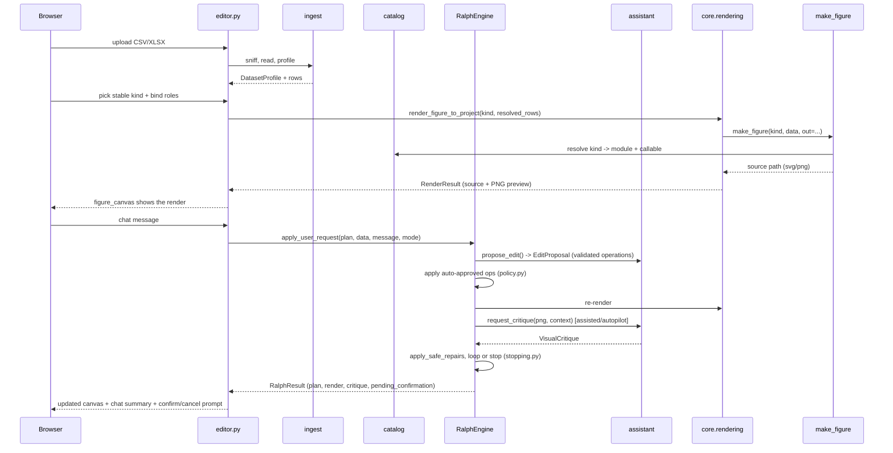

# Architecture

## Package layout

```
sprezzature_figures/
├── __init__.py, make_figure.py     # the library: make_figure, list_kinds, redraw, check_render, ...
├── cli.py, actions.py              # the click command line (sprezzature-figures / make-figure)
├── api.py, mcp.py                  # FastAPI routes, and the same routes as MCP tools
├── options.py, data_source.py,     # per-figure options, --data readers, DataFrame input,
│   frames.py, notebook.py          #   the FigurePath that draws itself in a notebook
├── redraw.py, render_checks.py,    # redraw from a picture, the static SVG check,
│   darkmode.py, fonts.py           #   dark-canvas rewrite, the three-Roboto font stacks
├── catalog/                        # figure registry (models.py, registry.py, figures.json)
├── core/                           # domain models + pure logic, no studio/* imports
│   ├── dataset.py                  #   DatasetProfile, ColumnProfile
│   ├── figure_plan.py              #   FigurePlan, StyleOptions, UserIntent
│   ├── operations.py               #   Transform + FigureOperation discriminated unions
│   ├── transformations.py          #   apply_transformations: filter / sort / aggregate / top-N / ...
│   ├── validation.py               #   validate_operation / validate_plan
│   ├── rendering.py                #   RenderResult, atomic writes, PNG preview
│   ├── projects.py                 #   ~/.sprezzature-studio/projects/<id>/ layout
│   ├── iterations.py               #   IterationRecord
│   └── history.py                  #   undo/redo/revert/compare
└── studio/                         # the NiceGUI app (base dependencies since 2026-11-01)
    ├── ingest/                     #   CSV/XLSX/clipboard readers + profiler
    ├── assistant/                  #   LLMClient, schemas, repair, FakeLLMClient, intent, recommend
    ├── recommendation/             #   deterministic compatibility filter + readability/goal score
    ├── ralph/                      #   the interactive engine (policy/apply/critic/stopping/...)
    ├── export/                     #   .sprezzature.zip bundle (code, images, alt text, manifest)
    ├── app.py, cli.py, state.py    #   the NiceGUI app and its sprezzature-studio launcher
    ├── config.py, i18n.py, theme.py, ui_strings.py
    ├── pages/editor.py
    └── components/                 #   data_panel, figure_canvas, chat_panel, engine_status,
                                    #   history_panel, property_panel, recommendation_cards
```

`core/` never imports from `studio/*`; it's the layer that could, in
principle, be reused by something other than this specific NiceGUI app.
`studio/*` depends on `core/` and on each other in one direction: `ingest`
→ `assistant`/`ralph` → `pages`/`components`. `ralph/` depends on
`assistant/` (for the LLM client and schemas) but not the reverse.

## Request flow



## Where a render actually lives

Every render is isolated per project, per iteration, never a shared
`assets/` directory (plan §8):

```
~/.sprezzature-studio/projects/<slug>-<8hex>/
├── manifest.json          # ProjectManifest: name, source, current_iteration pointer
├── source/, data/
├── iterations/
│   ├── 0001/
│   │   ├── plan.json      # the FigurePlan after this iteration
│   │   ├── event.json     # the full IterationRecord
│   │   ├── render.svg     # (or render.png, depending on the generator's renderer)
│   │   ├── preview.png    # always PNG, for the browser and the VLM
│   │   └── critique.json  # the vision model's critique, when one was asked for
│   └── 0002/
└── exports/
    └── <project-name>.sprezzature.zip
```

Writes are atomic (`core.rendering.atomic_write_bytes`/`atomic_write_text`:
write to a sibling temp file, then `os.replace`), so a crash mid-render
never leaves a truncated file behind.

## Transformations

`FigurePlan.transformations` (filter, sort, aggregate, top-N, group-others,
calculate) are executed, not only recorded. `pages/editor.py` and
`export/bundle.py` both run `core.transformations.apply_transformations`
over the imported rows before rendering, so a filter or a sort asked for in
the chat changes the figure, and the exported bundle reproduces the same
rows. A transformation that names a missing column is skipped with a note
rather than raising.
